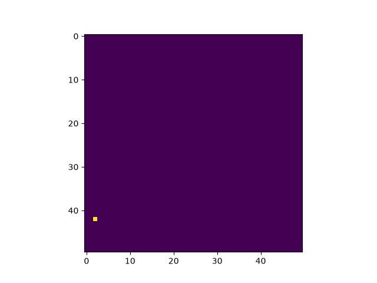
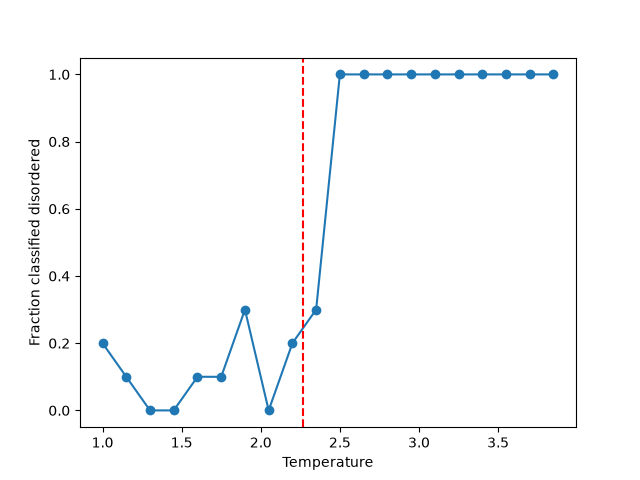
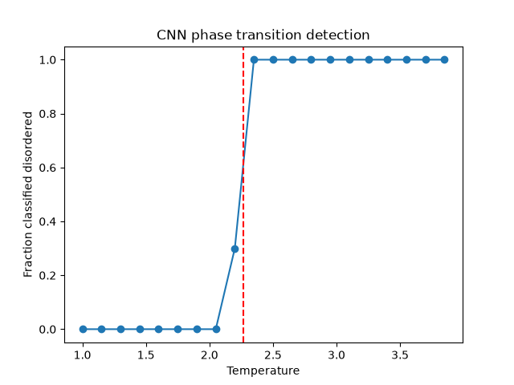
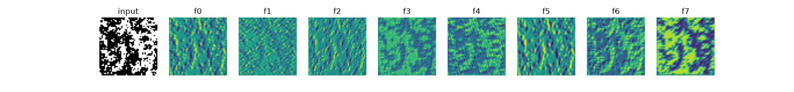
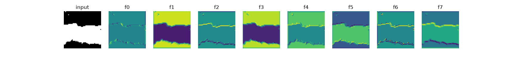
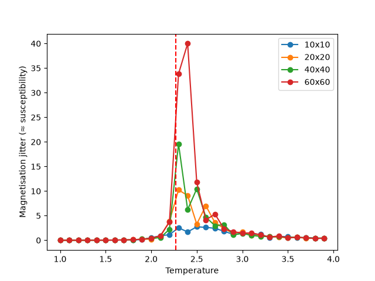

# 2D Ising Model with Monte Carlo Simulation (Statistical Mechanics, Theoretical Physics)

A from-scratch simulation of the **2D Ising model** on a square lattice, using the **Metropolis algorithm**. It reproduces the real thermodynamic behaviour of a ferromagnet: at low temperature the system spontaneously orders, and at high temperature it dissolves into disorder. Everything here, the lattice, the energy function, the flip rule, the dynamics — is implemented directly in NumPy with no physics libraries.

## The idea

The model is a grid of "spins," each either `+1` or `-1`. The single rule driving everything: **a spin wants to point the same way as its four neighbours.** Two aligned neighbours are a low-energy (stable) pair; two opposed neighbours are high-energy (tense). Temperature works against this ordering by randomly knocking spins out of alignment.

The competition between alignment (order) and temperature (chaos) is the whole story, and it produces a genuine phase transition.

## How it works

**Lattice.** An `N × N` grid of `±1`, initialised randomly. The grid uses **periodic boundary conditions** : the top edge wraps to the bottom and the left to the right, so the lattice behaves like the surface of a torus with no edges.

**Energy of a spin.** For a spin `s` with neighbour sum `S`:

```
E = -s * S
```

Aligned with its neighbourhood → low energy; clashing → high energy.

**The flip decision (Metropolis).** To decide whether a spin flips, compute the energy change it would cause:

```
ΔE = 2 * s * S
```

- If `ΔE ≤ 0`, the flip lowers (or doesn't raise) energy → **always accept it.**
- If `ΔE > 0`, the flip costs energy → **accept it only with probability**
  `p = exp(-ΔE / T)`, by drawing a random number and comparing.

That probabilistic acceptance is where temperature enters. Hot (`T` large) → costly flips happen often → chaos. Cold (`T` small) → costly flips almost never happen → the system freezes into order.

**Sweeps.** One *sweep* applies the flip decision to every cell once. The system is evolved by repeating sweeps many times, letting order (or disorder) spread across the lattice.

## Results

All runs use a 50×50 lattice. Yellow and purple represent the two spin states.

### T = 1 — Cold (ordered)



*Figure 1 : Ising model at T=1 (Cold & Ordered)*

Almost the whole grid turns one colour. The spins have all lined up with their neighbours. When it's cold enough, spins agree with the ones around them and the entire grid falls into line. This is the ordered state. The single odd dot is just one spin briefly knocked out of place; even a cold grid has a tiny bit of jitter.

### T = 0.1 — Frozen too fast (stuck)


*Figure 2 : Ising model at T=0.1. This rapid-cooling trap is known as quenching.*

Strangely, going *colder* makes the order *worse*, not better. Cooled this fast, the grid freezes almost instantly into whatever messy pattern it happened to be in, and gets stuck with two big blocks that can't merge. There isn't enough heat left to let the border between them move, so it never reaches the clean single-colour state it "should" end up in.

It's like metalwork: cool metal slowly and you get a clean crystal; cool it too fast and you lock in the flaws. How you cool matters as much as how cold you end up. (This is the idea behind a resolution method called **simulated annealing**.)

### T = 5 — Hot (disordered)


*Figure 3 : Ising model at T=5 (Hot & Disordered)*

The order is gone. You still get little clumps forming and breaking apart, neighbours still tug on each other a bit, but no single colour ever takes over. This is the **disordered** state or paramagnetic phase: it's so hot that the random jostling beats the spins' urge to line up.

Somewhere between cold and hot there's a tipping point, around **T ≈ 2.27** — where the grid flips from ordered to disordered. That exact number is a well-known result (first solved by Onsager).

## Running it

Requirements:

```
pip install numpy matplotlib scikit-learn torch
```

Run:

```
python ising.py
```

Adjust the lattice size (`size`) and temperature (`T`) at the top of the script to reproduce the figures above.

## Machine Learning: Rediscovering the Phase Transition

The second half of the project asks a harder question: can a machine learn to tell the ordered phase from the disordered one — and even find the critical temperature on its own, without ever being told it?

**The dataset** : The simulator doubles as a data factory. We generate hundreds of grids at clearly-cold temperatures (labelled "ordered") and clearly-hot temperatures (labelled "disordered"), **deliberately skipping the ambiguous region around T꜀.** Each settled grid is one labelled example.

**A linear model isn't enough.** A logistic-regression classifier scores no better than a coin flip (~0.5). The reason is physics, not a bug: the Ising model has up-down symmetry, so "ordered" grids come in two kinds — nearly all +1, or nearly all −1. The thing that identifies order is the magnitude of the magnetisation (distance from zero in either direction), which is a non-linear quantity, and a linear model fundamentally cannot express it.

**A non-linear model works.** A small neural network (one hidden layer) can build that non-linearity. Left unchecked it overfits — 100% on the grids it trained on, but only ~70% on unseen ones. Tuning regularisation closes that gap and lifts it to ~97% on held-out grids.

**The payoff — finding T꜀ it was never told.** Here's the great part. We freeze the trained model and feed it grids from every temperature — including the transition region it was never trained on. For each temperature we record the fraction of grids the model labels "disordered":



*Figure 4 : Phase transition (critical temperature T ≈ 2.27) detected by dense neural networks*

The curve stays flat at zero through the ordered phase, then lifts off right at *T ≈ 2.27* — the true critical temperature (red dashed line). The model was never given this number, and never saw a single grid from the transition region, yet it locates the phase boundary on its own. This reproduces the central idea of Carrasquilla & Melko, *Nature Physics* (2017).

How sharp this curve looks depends mostly on regularisation. The plot above uses strong regularisation (α=10). The same model with weak regularisation produces a jagged curve from the identical ~10 grids per temperature and the same architecture. So regularisation, not just sample count or network type, is the main lever on how cleanly the transition shows up. (More grids per temperature and a CNN sharpen it further.)

The exact curve also shifts a little from run to run. It reflects this particular model's opinion, so it wobbles with the training data and the random split. What stays fixed across every version is the liftoff near T ≈ 2.27; that physics characteristic is the exact thing the model learned, despite not being told the boundary was around 2.27. The liftoff is reproducible, hence reliable.

Run the classifier (after generating the dataset with ising.py):

```
python classifier.py
```

## A Sharper Result : Convolutional Neural Network (CNN)

The dense network works, but it has two weaknesses: it flattens each grid into a list of 2500 numbers, throwing away which spins are neighbours, and with ~40,000 weights it overfits unless regularised.

A **convolutional network** fixes both. Instead of flattening, it slides small pattern-detectors (filters) across the grid, that scan local neighbourhoods, exactly the local spin-alignment that defines order. And because the same filter is reused across the whole grid (weight sharing), the entire feature extractor is a few hundred parameters instead of tens of thousands, so it generalises without regularisation at all.

The result:

- 100% accuracy on held-out grids - with no regularisation. The architecture does the job that alpha had to do for the dense net.
- A near-perfect step at the transition :



*Figure 5: Phase transition (critical temperature T ≈ 2.27) detected by CNN*

Compare this to the dense network's jagged curve. The CNN gives a clean step — flat zero through the ordered phase, a single ambiguous point right at the transition, then a flat 1.0 across the disordered phase — crossing almost exactly at T ≈ 2.27. That lone in-between point sits precisely where grids are genuinely ambiguous: the model is uncertain only where the physics itself is uncertain.

Same physics, same task, same ~10 grids per temperature. The only change is an architecture shaped like the problem: fewer parameters, no regularisation, a sharper answer.

Run the CNN:

```
python cnn.py
```

## Food for thought

The CNN beats the larger, regularised dense network with a fraction of the parameters and no regularisation at all. Not because it is bigger or more heavily tuned, but because its structure matches the problem (local filters for local spin interactions). The lesson is not "more parameters" or "more regularisation," but choosing a model whose built-in assumptions fit the data.

## What the CNN Learned (Opening the Black Box)

A CNN is often called a black box, but here we can look inside. Pulling out the trained conv filters shows 8 small 3×3 patterns, each a mix of positive and negative weights. A filter with positives on one side and negatives on the other is a boundary detector: it fires strongest on a patch where spins flip from +1 to −1, a domain wall.

Applying the filters to real grids (the feature maps) makes this vivid:



*Figure 6: Feature maps on a disordered grid*




*Figure 7: Feature maps on a ordered grid*

The contrast: busy on disordered, quiet on ordered. The network taught itself to hunt domain walls and classify by how much boundary it finds, which is exactly the physical difference between the phases (ordered = big domains, disordered = walls everywhere). Nobody specified this, it was discovered from data.

## Measuring T꜀ from the Physics (a cross-check)

The ML models find the transition, but we can also measure T꜀ directly from the physics, with no model at all, and check if the two agree.

Near T꜀ (T ≈ 2.27) the system is torn between order and disorder, so its magnetisation fluctuates wildly. That fluctuation is the susceptibility, χ = N · Var(M) / T, and it peaks at T꜀. Scanning temperature:



*Figure 8: Susceptibility peak and finite-size scaling*

The peak lands on T ≈ 2.27, and across several grid sizes it sharpens and converges onto 2.27 as the lattice grows. This is finite-size scaling, how physicists actually pin down T꜀. 
This is an independent confirmation: the pure-physics T꜀ and the machine-learned T꜀ agree.

## Performance : Vectorised Simulation

The original simulation loops over every cell in Python, is correct, but slow. The vectorised version (ising_vectorised.py) runs the same Metropolis dynamics as whole-array NumPy operations: neighbour sums via np.roll, and a checkerboard update (flip all "black" cells at once, then all "white") so no two neighbouring spins ever flip in the same step. Same physics, ~100× faster, which is what makes the finite-size scaling above feasible.

## Roadmap

[x] Train a classifier to **detect the phase transition directly from spin configurations** — reproducing Carrasquilla & Melko, Nature Physics (2017).

[x] Replace the dense network with a **convolutional neural network (CNN)** to sharpen the transition curve, 100% accuracy, no regularisation needed.

[x] Measure T꜀ directly from the physics (susceptibility + finite-size scaling).

[x] Vectorise the simulation (checkerboard update, ~100× faster).

[x] Visualise the learned filters, they are domain-wall detectors.


## Notes

Built from scratch as an exercise in implementing, statistical mechanics: lattice with periodic boundaries, local energy, the Metropolis acceptance rule, and Monte Carlo sweeps.