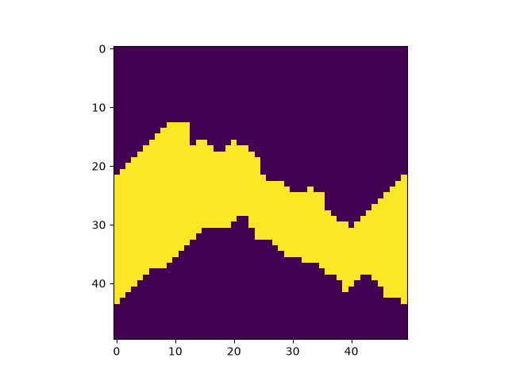
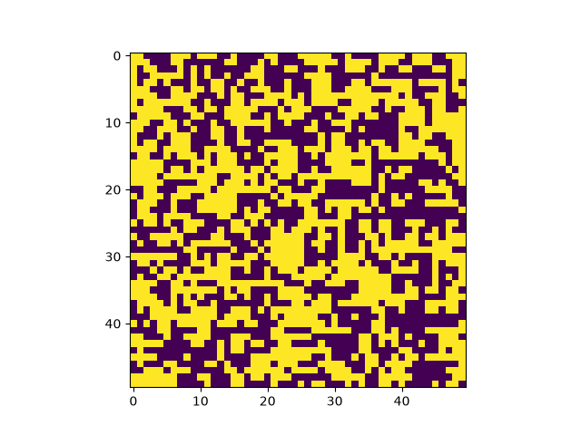

# 2D Ising Model with Monte Carlo Simulation (Statistical Mechanics)

A from-scratch simulation of the **2D Ising model** on a square lattice, using the **Metropolis algorithm**. It reproduces the real thermodynamic behaviour of a ferromagnet: at low temperature the system spontaneously orders, and at high temperature it dissolves into disorder. Everything here, the lattice, the energy function, the flip rule, the dynamics — is implemented directly in NumPy with no physics libraries.

## The idea

The model is a grid of "spins," each either `+1` or `-1`. The single rule driving everything: **a spin wants to point the same way as its four neighbours.** Two aligned neighbours are a low-energy (stable) pair; two opposed neighbours are high-energy (tense). Temperature works against this ordering by randomly knocking spins out of alignment.

The competition between alignment (order) and temperature (chaos) is the whole story, and it produces a genuine phase transition.

## How it works

**Lattice.** An `N × N` grid of `±1`, initialised randomly. The grid uses **periodic boundary conditions** : the top edge wraps to the bottom and the left to the right, so the lattice behaves like the surface of a torus with no edges.

**Energy of a spin.** For a spin `s` with neighbour sum `S`:

```
E = -s * S
```

Aligned with its neighbourhood → low energy; clashing → high energy.

**The flip decision (Metropolis).** To decide whether a spin flips, compute the energy change it would cause:

```
ΔE = 2 * s * S
```

- If `ΔE ≤ 0`, the flip lowers (or doesn't raise) energy → **always accept it.**
- If `ΔE > 0`, the flip costs energy → **accept it only with probability**
  `p = exp(-ΔE / T)`, by drawing a random number and comparing.

That probabilistic acceptance is where temperature enters. Hot (`T` large) → costly flips happen often → chaos. Cold (`T` small) → costly flips almost neverhappen → the system freezes into order.

**Sweeps.** One *sweep* applies the flip decision to every cell once. The system is evolved by repeating sweeps many times, letting order (or disorder) spread across the lattice.

## Results

All runs use a 50×50 lattice. Yellow and purple represent the two spin states.

### T = 1 — Cold (ordered)


Almost the whole grid turns one colour. The spins have all lined up with their neighbours. When it's cold enough, spins agree with the ones around them and the entire grid falls into line. This is the orderedstate. The single odd dot is just one spin briefly knocked out of place; even a cold grid has a tiny bit of jitter.

### T = 0.1 — Frozen too fast (stuck)



Strangely, going *colder* makes the order *worse*, not better. Cooled this fast, the grid freezes almost instantly into whatever messy pattern it happened to be in, and gets stuck with two big blocks that can't merge. There isn't enough heat left to let the border between them move, so it never reaches the clean single-colour state it "should" end up in.

It's like metalwork: cool metal slowly and you get a clean crystal; cool it too fast and you lock in the flaws. How you cool matters as much as how cold you end up. (This is the idea behind a method called **simulated annealing**.)

### T = 5 — Hot (disordered)



The order is gone. You still get little clumps forming and breaking apart, neighbours still tug on each other a bit, but no single colour ever takes over. This is the **disordered** state or paramagnetic phase: it's so hot that the random jostling beats the spins' urge to line up.

Somewhere between cold and hot there's a tipping point, around **T ≈ 2.27** — where the grid flips from ordered to disordered. That exact number is a well-known result (first solved by Onsager).

## Running it

Requirements:

```
pip install numpy matplotlib scikit-learn
```

Run:

```
python ising.py
```

Adjust the lattice size (`size`) and temperature (`T`) at the top of the script to reproduce the figures above.

## Machine Learning: Rediscovering the Phase Transition

The second half of the project asks a harder question: can a machine learn to tell the ordered phase from the disordered one — and even find the critical temperature on its own, without ever being told it?

**The dataset** : The simulator doubles as a data factory. We generate hundreds of grids at clearly-cold temperatures (labelled "ordered") and clearly-hot temperatures (labelled "disordered"), deliberately skipping the ambiguous region around T꜀. Each settled grid is one labelled example.

**A linear model isn't enough** A logistic-regression classifier scores no better than a coin flip (~0.5). The reason is physics, not a bug: the Ising model has up-down symmetry, so "ordered" grids come in two kinds — nearly all +1, or nearly all −1. The thing that identifies order is the magnitude of the magnetisation (distance from zero in either direction), which is a non-linear quantity, and a linear model fundamentally cannot express it.

**A non-linear model works** A small neural network (one hidden layer) can build that non-linearity. After tuning regularisation and adding more data to control overfitting, it reaches ~100% accuracy on held-out grids.

**The payoff — finding T꜀ with no supervision** Here's the great part. We freeze the trained model and feed it grids from every temperature — including the transition region it was never trained on. For each temperature we record the fraction of grids the model labels "disordered":


The curve stays flat at zero through the ordered phase, then lifts off right at *T ≈ 2.27* — the true critical temperature (red dashed line). The model was never given this number, and never saw a single grid from the transition region, yet it locates the phase boundary on its own. This reproduces the central idea of Carrasquilla & Melko, *Nature Physics* (2017).

(The curve is still noisy above the transition — only ~10 grids per temperature, and a dense network rather than a convolutional one. More samples and a CNN sharpen it.)

Run the classifier (after generating the dataset with ising.py):

```
python classifier.py
```

## Roadmap

[x] Train a classifier to **detect the phase transition directly from spin configurations** — reproducing Carrasquilla & Melko, Nature Physics (2017).
[ ] Replace the dense network with a **convolutional neural network (CNN)** to respect the 2D structure and sharpen the transition curve.
[ ] Increase samples per temperature to reduce noise in the transition plot.

## Notes

Built from scratch as an exercise in implementing, statistical mechanics: lattice with periodic boundaries, local energy, the Metropolis acceptance rule, and Monte Carlo sweeps.